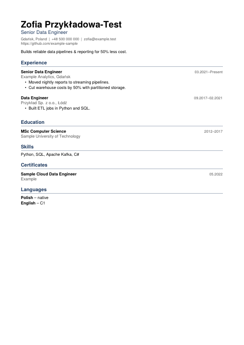
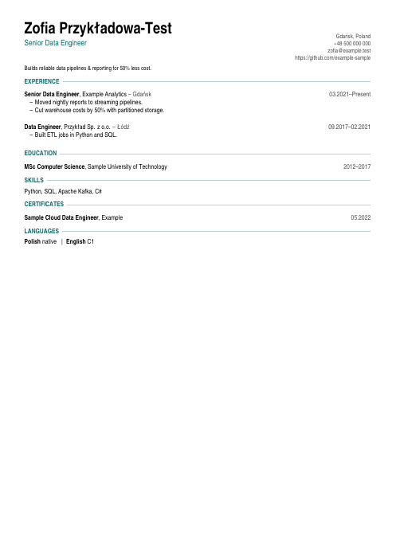
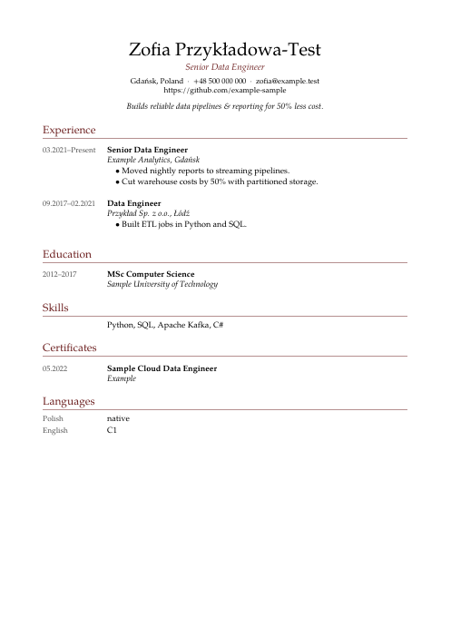
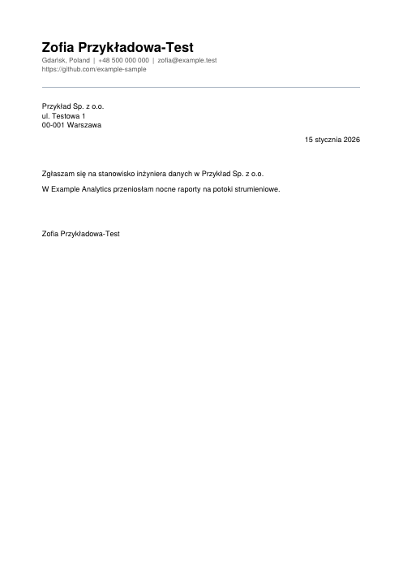

# CV and cover letter templates

jaa builds CVs and cover letters by filling a LaTeX template with LaTeX generated from your
confirmed profile (ADR 0012, ADR 0029). This page is the **template contract**: what a template
must provide so jaa can fill it. `jaa templates check PATH` checks a template against it.

## Shipped templates

| Id | Kind | Look |
| --- | --- | --- |
| `moderncv-classic` | CV (default) | name header, dates in a left column |
| `moderncv-banking` | CV | centred header, full-width sections |
| `moderncv-casual` | CV | large right-aligned name, contact details in the footer |
| `jaa-minimal` | CV | ATS-first single column, dates flush right ([below](#jaas-own-designs)) |
| `jaa-compact` | CV | dense one-page layout for senior profiles |
| `jaa-serif` | CV | serif, dates in a margin column, long-form |
| `moderncv-letter` | cover letter (default) | moderncv letter |
| `jaa-minimal-letter` | cover letter | matches `jaa-minimal` |

`jaa templates show ID --preview` builds a preview PDF from synthetic sample data (never your
profile) into `previews/` in the data directory.

The template files are MIT-licensed (this repository). The `moderncv-*` templates use the
moderncv class (LPPL 1.3c), which comes with the TeX distribution or Tectonic's bundle and is not
shipped with jaa.

## jaa's own designs

The `jaa-*` templates (ADR 0030) do not use moderncv: each one defines the contract's macros
itself on top of LaTeX's `article` class, so they double as worked examples for writing your
own. They share these choices:

- **ATS first.** One reading order (the header, then each section top to bottom; an entry's
  title before its details), real text everywhere, no icons, standard section headings, no
  hyphenation, ragged lines, and no kerning (strong kerns such as "Te" make text extraction
  split words). The tests check that the extracted text contains the facts in reading order.
- **Fonts and licences.** TeX Gyre Heros, Heros Condensed and Pagella (GUST Font License), loaded
  by file name with `fontspec`, plus `titlesec`, `needspace` and `etoolbox` (LPPL). All come
  with TeX Live, MiKTeX and Tectonic's bundle; nothing is shipped with jaa. The fonts have the
  full Polish alphabet.
- **English and Polish.** Headings and dates come from jaa in the CV's language; babel loads
  the language's hyphenation patterns, though hyphenation itself is off.
- **Photo and consent** appear only when you pass `--photo` or have saved a consent clause; the
  consent clause sits in small type at the bottom of the last page.
- **Paper.** A4 or US Letter, chosen per build ([Paper](#paper)); the margins follow.
- **Page breaks.** A heading is never the last line of a page, an entry's first lines stay
  together, and long entries break between bullet points.

| Template | Intended use | Preview (synthetic data) |
| --- | --- | --- |
| `jaa-minimal` | Most applications: a clean single column that every applicant tracking system reads. 10pt sans, 1–2 pages. |  |
| `jaa-compact` | Senior and lead profiles that must fit one page: condensed type, narrow margins, one line per role, contact details beside the name. |  |
| `jaa-serif` | Academic, public-sector and traditional employers, and long-form CVs: serif type, dates and language names in a margin column, breaks cleanly onto later pages. |  |
| `jaa-minimal-letter` | Cover letters that match `jaa-minimal`. |  |

Polish previews: [jaa-minimal](images/templates/jaa-minimal-pl.png),
[jaa-compact](images/templates/jaa-compact-pl.png), [jaa-serif](images/templates/jaa-serif-pl.png).
They were made with `jaa templates show ID --preview --language LANG` and
`pdftoppm -png -r 60 -singlefile`; rebuild them when a design changes.

## Adding your own

```bash
jaa templates check my-template.zip          # report problems without adding
jaa templates add my-template.zip --id mine  # stored as user-mine; again with changes → @2
jaa templates add --candidate 3 --id old-cv  # from `jaa import cv cv.tex --as-template`
jaa templates default user-mine              # used when no --template is given
jaa cv build --template user-mine@1          # one build with a specific version
jaa templates delete user-mine               # every version; built PDFs are kept
```

A template is a single `.tex` file, a folder or a `.zip` archive. In a folder or archive the
main file is the `.tex` file with `\documentclass` (name it with `--main` if there are several),
and every path is relative to its folder. Allowed files: `.tex .cls .sty .cfg .def .clo .fd`
(UTF-8 text) and `.png .jpg .jpeg .pdf .otf .ttf`; at most 100 files and 5 MB. Hidden files,
`__MACOSX`, files outside the main file's folder and other types are skipped and listed. Files
named `document.*` or `photo.*` at the top level clash with jaa's build and are refused.

Added templates are stored in the database (and in exports and backups). Each version is
immutable, and every PDF's manifest records the template's id, version and SHA-256 over all its
files.

## Slot lines

The main file has these lines, each exactly once and alone on its line. jaa replaces each one
with generated LaTeX; every other line is copied unchanged.

| Slot | Where | Becomes |
| --- | --- | --- |
| `%%jaa:babel%%` | preamble | `\usepackage[english]{babel}` or `[polish]` |
| `%%jaa:header%%` | preamble | `\name`, `\title`, `\address`, `\mobile`, `\email`, `\extrainfo`, `\photo`, `\quote` |
| `%%jaa:body%%` | document | the CV sections; in a cover letter, the paragraphs |
| `%%jaa:consent%%` | document, CV only | your consent clause, or nothing |
| `%%jaa:letter%%` | preamble, cover letter only | `\recipient`, `\date`, `\opening`, `\closing` |

Preamble slots come before `\begin{document}`, the others after it.

## Paper

Every template builds on A4 or US Letter (ADR 0033). The size comes from `--paper a4|letter` on
`jaa cv build`, `jaa cv tailor build`, `jaa cv tailor letter` and `jaa templates show
--preview` (or `paper` on the `generate_cv_pdf` MCP tool), else from the
`documents.paper_size` preference (`jaa preferences set documents.paper_size letter`), else A4.
Each PDF's manifest records it as `"paper": "a4"` or `"letter"`.

jaa sets the size as an option of your main file's `\documentclass`: it replaces a paper option
already there (`a4paper`, `letterpaper`, `a5paper`, …) or adds one. Standard classes, moderncv
and `geometry` all follow the class option, so a template needs nothing else; set margins with
`geometry` options such as `margin=18mm` or `scale=0.75`, never with a paper size.

The main file must not fix the paper anywhere else; `jaa templates check` refuses a paper name
outside the class options (e.g. `\usepackage[a4paper]{geometry}`), `paper=`, `paperwidth=` or
`paperheight=` options, assignments to `\paperwidth`, `\paperheight`, `\pdfpagewidth` or
`\pdfpageheight`, and `\special{papersize=…}`. Reading those dimensions
(`\textwidth=\paperwidth`) is fine. A template's own `.cls` or `.sty` files are not scanned, so
every build also checks the PDF's page size and saves nothing if a page is not the chosen paper.

## Macros

The generated LaTeX calls moderncv's macros. With `\documentclass{moderncv}` they all exist.
Any other class must define each of these itself (with `\newcommand`, `\def`,
`\NewDocumentCommand`, ... in the main file or a local `.sty`/`.cls`):

- CV: `\name{first}{last}`, `\address{line}{}{}`, `\mobile`, `\email`, `\extrainfo`,
  `\photo[size][frame]{file}`, `\quote`, `\makecvtitle`,
  `\cventry{dates}{title}{organization}{location}{}{description}`, `\cvitem{label}{text}`,
  `\cvlistitem{text}`, `\cvlanguage{name}{level}{comment}`; plus `\section` and `\title` from
  LaTeX.
- Cover letter: `\name`, `\address`, `\mobile`, `\email`, `\extrainfo`,
  `\recipient{name}{address}`, `\opening`, `\closing`, `\makelettertitle`,
  `\makeletterclosing`; plus `\date`.

Header lines are left out when the profile has no value, and `\photo` appears only when you pass
`--photo`. All text from your profile is escaped, so it can never act as a LaTeX command.

## File access

LaTeX engines can read any file you can read, and Tectonic has no sandbox. So an added template
must keep to its own folder:

- Refused: absolute, `~` or `..` paths (in `\input`, `\includegraphics`, `\openin`, font paths,
  ...), `\directlua` and other Lua code, `\write18`, `\ShellEscape`, `\openout` and piped
  `\input|`.
- Warned about: `\csname`, `\catcode` and `\scantokens`, which can build a file name the check
  cannot see. Add such templates only from sources you trust.
- At build time, a build in which Tectonic reports reading an absolute path is refused and no
  PDF is saved. XeLaTeX and LuaLaTeX run with kpathsea's paranoid file access instead.

Comments are ignored by these checks.

## Recommendations (warnings, not errors)

- Turn hyphenation off (`\hyphenpenalty=10000`): applicant tracking systems miss split words.
- Keep text as text: no information only in icons or images. jaa checks the PDF's extractable
  text after every build and lists what it cannot find.
- Use fonts with Polish diacritics if you build Polish CVs.
